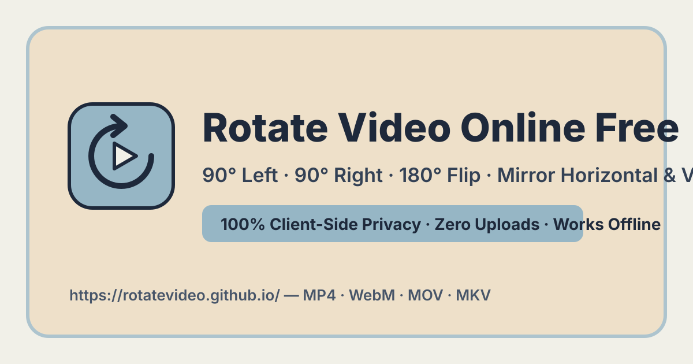
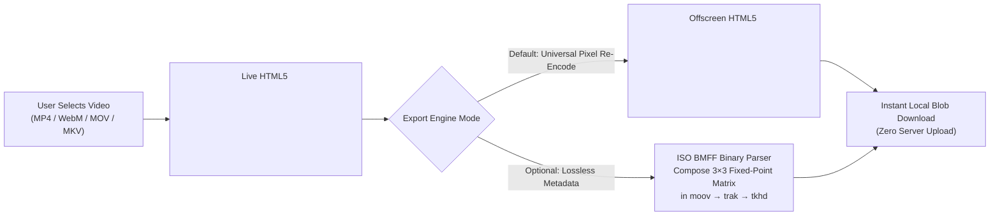

<div align="center">


# Rotate Video Online

### Instant, 100% Client-Side Browser Video Rotator & Flipper

**Rotate MP4, WebM, MOV, and MKV videos 90° Left, 90° Right, 180°, or Mirror Horizontally & Vertically — directly in your browser with zero server uploads, zero watermarks, and full offline PWA support.**

[**🌐 Live Application (rotatevideo.github.io)**](https://rotatevideo.github.io/) · [**🐛 Report Bug**](https://github.com/rotatevideo/rotatevideo.github.io/issues) · [**✨ Request Feature**](https://github.com/rotatevideo/rotatevideo.github.io/issues) · [**☕ Support the Developer**](https://kisharadilshan.gumroad.com/coffee)

<br />

[](https://rotatevideo.github.io/)
[](https://astro.build/)
[](https://tailwindcss.com/)
[](https://www.typescriptlang.org/)
[-EEE0C9?style=for-the-badge&logo=shield&logoColor=1E293B)](https://rotatevideo.github.io/)
[](https://rotatevideo.github.io/)
[](#🌍-multi-language-support-8-languages)
[](./LICENSE)

<br />



</div>

---

## 📖 Table of Contents

- [Overview](#-overview)
- [Key Features](#-key-features)
- [How the Client-Side Video Engine Works](#-how-the-client-side-video-engine-works)
- [Why RotateVideo vs. VLC & Cloud Video Editors](#-why-rotatevideo-vs-vlc--cloud-video-editors)
- [Design System & Color Palette](#-design-system--color-palette)
- [Multi-Language Support (8 Languages)](#-multi-language-support-8-languages)
- [Project Architecture](#-project-architecture)
- [Getting Started (Local Development)](#-getting-started-local-development)
- [Deployment (GitHub Pages CI/CD)](#-deployment-github-pages-cicd)
- [SEO, Structured Data & Accessibility](#-seo-structured-data--accessibility)
- [Support the Developer](#-support-the-developer)
- [License](#-license)

---

## 🎯 Overview

Recording a video on a smartphone or action camera only to discover it plays sideways (`90°` or `270°`) or upside-down (`180°`) is a common frustration. Most existing solutions force users into an unpleasant trade-off:

1. **Cloud Online Video Editors** require uploading hundreds of megabytes of private footage to remote servers, waiting in rendering queues, and dealing with paywalls, watermarks, or compressed bitrates.
2. **Desktop Media Players (e.g., VLC Media Player)** bury permanent rotation inside 12+ nested menus (*Tools → Effects and Filters → Geometry → Media → Convert/Save → Edit Profile → Video Codec → Filters*).

**Rotate Video Online** ([https://rotatevideo.github.io/](https://rotatevideo.github.io/)) solves this in **3 clicks** entirely inside your browser:

1. **Drop or Choose Video** (`MP4`, `WebM`, `MOV`, `MKV`)
2. **Rotate or Flip Live** (`90° Left`, `90° Right`, `180°`, `Flip Horizontal`, `Flip Vertical`) with smooth 60fps hardware-accelerated preview
3. **Download Rotated Video** instantly — processed 100% on your device

---

## ✨ Key Features

| Feature | Description |
| :--- | :--- |
| 🔒 **100% Client-Side Privacy** | Zero server uploads, zero cloud storage, and zero database tracking. Your video files never leave your computer or phone. |
| 🎬 **Universal Pixel Re-Encode Engine** | Renders every frame through an HTML5 `<canvas>` 2D affine transformation pipeline with swapped width/height dimensions while preserving original audio via Web Audio API + `MediaRecorder`. |
| ⚡ **Smart Lossless MP4/MOV Engine** | Optional binary ISO Base Media File Format (`tkhd` box) 3×3 matrix patcher that composes orientation metadata in milliseconds without re-encoding. |
| 🪞 **Full Rotation & Mirror Controls** | Rotate **90° Counter-Clockwise (Left)**, **90° Clockwise (Right)**, **180° Upside-Down**, **Flip Horizontal (Selfie Mirror)**, and **Flip Vertical**. |
| 🎞️ **Smooth 60fps Live Preview** | Hardware-accelerated CSS transform animations (`transition-transform duration-500 ease-out`) with automatic aspect-ratio scaling so rotated frames never clip. |
| 📲 **Offline-Capable PWA** | Complete `manifest.webmanifest` and cache-first Service Worker (`sw.js`) allow users to install the app to their home screen or desktop and rotate videos **100% offline**. |
| 📱 **Ultra-Responsive UI** | First-fold workspace focus that shows only the upload dropzone initially and reveals rotation controls upon file selection; mobile/tablet navigation neatly collapses into a single menu toggle icon. |
| 🌗 **Light & Dark Theme** | High-contrast custom color palette with flash-free theme persistence in `localStorage`. |

---

## ⚙️ How the Client-Side Video Engine Works



1. **Universal Pixel Re-Encode Mode (Default)**:
   - Decodes the source video locally and creates an offscreen `<canvas>` with automatically swapped dimensions (`width = videoHeight`, `height = videoWidth` for `90°`/`270°` rotations so zero pixels are cropped).
   - Applies the exact 2D transformation (`ctx.translate`, `ctx.rotate`, `ctx.scale(flipX, flipY)`) on every frame while routing the original audio track silently through an `AudioContext` `MediaStreamDestination`.
   - Encodes a high-bitrate (`8 Mbps`) output video guaranteed to display rotated in **100% of video players, social media platforms, and operating systems**.
2. **Smart Lossless Metadata Mode (MP4 / MOV)**:
   - Inspects the binary ISO Base Media File Format (`ftyp`, `moov`, `trak`, `tkhd`) in an `ArrayBuffer`.
   - Reads the existing `16.16` fixed-point transformation matrix inside the visual track's `tkhd` box, multiplies it by the user's rotation matrix, and writes the updated 36-byte matrix back in `< 25 ms`.

---

## 🆚 Why RotateVideo vs. VLC & Cloud Video Editors

| Capability | **RotateVideo (`rotatevideo.github.io`)** | **VLC Media Player** | **Cloud Online Video Editors** |
| :--- | :---: | :---: | :---: |
| **Workflow Complexity** | **3 Clicks** (Upload → Rotate → Download) | 12+ Clicks across Filter & Convert dialogs | Upload wait → Timeline → Export queue |
| **Data Privacy** | **100% Local (Zero Uploads)** | Local Desktop App | Uploads private videos to cloud servers |
| **Watermarks / Paywalls** | **None (100% Free & MIT Open Source)** | None | Watermarks or 720p limits on free tiers |
| **Portrait ↔ Landscape** | **Auto-swaps dimensions (No cropping)** | Often crops edges unless manually configured | Often adds black bars or crops frame |
| **Works Offline on Mobile** | **Yes (Installable Offline PWA)** | Mobile VLC cannot export rotated files | Requires fast internet connection |

---

## 🎨 Design System & Color Palette

RotateVideo is engineered with a calm, high-contrast, distraction-free color system designed for long editing sessions in both Light and Dark environments:

| Token Role | Hex Code | Preview | Usage |
| :--- | :--- | :---: | :--- |
| **Primary Accent** | `#96B6C5` |  | Primary CTA buttons, active badges, focus rings, brand accents |
| **Secondary Accent** | `#ADC4CE` |  | Card borders, hover states, dividers, secondary badges |
| **Secondary Surface (Light)** | `#EEE0C9` |  | Main Video Rotator workspace box, cards, navbar buttons |
| **Main Background (Light)** | `#F1F0E8` |  | Page canvas background, inner dropzone surface |
| **Light Mode Text** | `#1E293B` |  | High-contrast primary typography & iconography in Light Mode |
| **Dark Mode Background** | `#182026` |  | Page canvas background in Dark Mode |
| **Dark Mode Surface** | `#222D35` |  | Main Video Rotator workspace box & cards in Dark Mode |
| **Dark Mode Text** | `#F1F0E8` |  | High-contrast primary typography in Dark Mode |

---

## 🌍 Multi-Language Support (8 Languages)

The interface includes instant, zero-reload client-side localization (`src/i18n/translations.ts`) with automatic browser language detection and `localStorage` persistence:

| Code | Language | Native Label |
| :---: | :--- | :--- |
| `en` | **English** | English |
| `es` | **Spanish** | Español |
| `pt` | **Portuguese** | Português |
| `de` | **German** | Deutsch |
| `fr` | **French** | Français |
| `ja` | **Japanese** | 日本語 |
| `zh` | **Simplified Chinese** | 简体中文 |
| `ru` | **Russian** | Русский |

---

## 📁 Project Architecture

```text
rotatevideo.github.io/
├── .github/
│   └── workflows/
│       └── deploy.yml              # Official Astro GitHub Pages CI/CD pipeline
├── public/
│   ├── .nojekyll                   # Bypasses Jekyll processing on GitHub Pages
│   ├── favicon.svg                 # Scalable vector app icon
│   ├── manifest.webmanifest        # PWA Web Application Manifest
│   ├── og-image.svg                # 1200×630 Open Graph & Twitter Card social banner
│   ├── robots.txt                  # Crawler directives + dual sitemap pointers
│   ├── sitemap.xml                 # Direct Google Search Console <urlset> sitemap
│   └── sw.js                       # Offline-first Service Worker asset cache
├── src/
│   ├── components/
│   │   ├── Breadcrumb.astro        # Schema.org Breadcrumb navigation landmark
│   │   ├── Footer.astro            # Semantic footer + PWA offline installation modal
│   │   ├── Navbar.astro            # Responsive navbar (Desktop bar + Mobile toggle menu)
│   │   ├── SeoContent.astro        # Below-the-fold How-To guide, VLC table & FAQ accordion
│   │   └── VideoRotator.astro      # First-fold interactive Video Rotator workspace
│   ├── i18n/
│   │   └── translations.ts         # Strongly-typed 8-language translation dictionary
│   ├── layouts/
│   │   └── BaseLayout.astro        # Document head, GTM/GA4, Open Graph & JSON-LD schemas
│   ├── pages/
│   │   └── index.astro             # Main application route
│   └── utils/
│       └── videoEngine.ts          # Client-side Canvas re-encoder + MP4 tkhd matrix patcher
├── astro.config.mjs                # Astro + Tailwind CSS + @astrojs/sitemap configuration
├── package.json                    # Dependencies and build scripts
├── tailwind.config.mjs             # Custom design tokens and dark mode configuration
├── tsconfig.json                   # Strict TypeScript configuration
└── LICENSE                         # MIT License
```

---

## 🚀 Getting Started (Local Development)

### Prerequisites

- **Node.js** `v18.17.1+` or `v20+` / `v22+`
- **npm** `v9+`

### Installation & Commands

1. **Clone the repository:**
   ```bash
   git clone https://github.com/rotatevideo/rotatevideo.github.io.git
   cd rotatevideo.github.io
   ```

2. **Install dependencies:**
   ```bash
   npm install
   ```

3. **Start the local development server:**
   ```bash
   npm run dev
   ```
   Open `http://localhost:4321` in your browser.

4. **Build for production:**
   ```bash
   npm run build
   ```
   The static production build is generated in the `./dist/` directory.

5. **Preview the production build locally:**
   ```bash
   npm run preview
   ```

---

## 🌐 Deployment (GitHub Pages CI/CD)

This repository includes a pre-configured GitHub Actions workflow (`.github/workflows/deploy.yml`) using `withastro/action@v3` and `actions/deploy-pages@v4`:

1. Go to your GitHub repository **Settings → Pages**.
2. Under **Build and deployment → Source**, select **GitHub Actions**.
3. Push any commit to the `main` (or `master`) branch — GitHub Actions will automatically build the Astro site and deploy it to `https://rotatevideo.github.io/`.

---

## 🔍 SEO, Structured Data & Accessibility

- **Rich Schema.org JSON-LD** (`WebApplication`, `HowTo`, `FAQPage`, and `BreadcrumbList`) with strict adherence to Google Webmaster Guidelines (zero fabricated review ratings).
- **Bulletproof Google Search Console Indexing**: Combines `@astrojs/sitemap` (`sitemap-index.xml` & `sitemap-0.xml`) with a static `public/sitemap.xml` `<urlset>` and `public/.nojekyll`.
- **WCAG AA Accessibility**: Semantic HTML5 landmarks (`<header>`, `<nav>`, `<main>`, `<section>`, `<footer>`), full keyboard operability, descriptive `aria-label` attributes on all controls, `aria-pressed` toggle states, and `aria-live="polite"` status announcements.

---

## ☕ Support the Developer

**Rotate Video Online** is free, ad-free, and open-source. If this tool saved you time or helped your workflow, please consider supporting ongoing development:

<div align="center">

[](https://kisharadilshan.gumroad.com/coffee)

**[https://kisharadilshan.gumroad.com/coffee](https://kisharadilshan.gumroad.com/coffee)**

</div>

---

## 📄 License

Distributed under the **MIT License**. See [`LICENSE`](./LICENSE) for full details.
